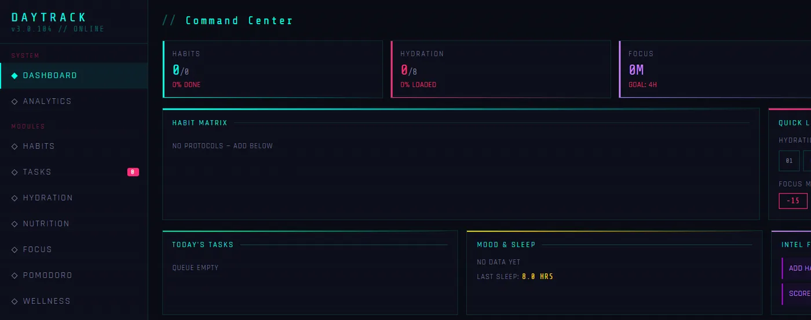
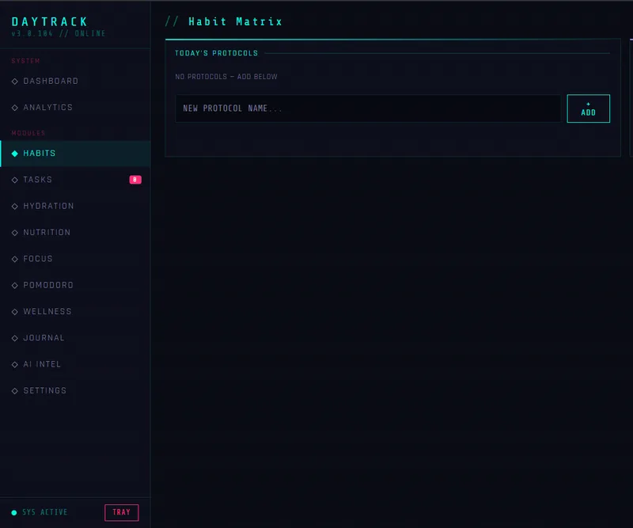
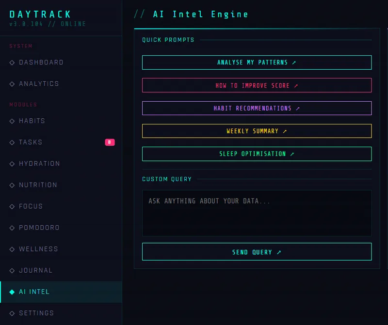

# DayTrack


A desktop productivity dashboard that tracks your **day-to-day activities**: habits, tasks, hydration, nutrition, focus sessions and a journal, all rolled into a daily score.

<p align="center">
  
</p>
<p align="center">
  
  
</p>

## Features

- **Command center:** today's habits, hydration, focus minutes and a daily score on one screen.
- **Habits:** add habits and tick them off, with streak tracking.
- **Tasks:** a simple to-do list.
- **Hydration:** log water units against a daily goal.
- **Nutrition:** keep a food log.
- **Focus and Pomodoro:** log focus minutes and run work and break timers.
- **Wellness and journal:** record mood and write daily entries.
- **Analytics:** averages and trends across days.
- **AI Intel:** quick prompts and custom questions about your day (see the note below).
- **Settings:** set daily goals for focus, water and calories, and switch between Cyberpunk, Minimal and Light themes.
- **CSV export:** export all your data, or just the journal, to a spreadsheet.
- **Local data:** your logs are saved on your computer as a JSON file, one entry per day.

## Tech stack

| Layer | Technology |
| --- | --- |
| Shell | Electron (main process plus a secure preload bridge) |
| UI | Single-file HTML, CSS and vanilla JavaScript |
| Charts | Chart.js (loaded from a CDN) |
| Storage | `daytrack.json` in the app's user-data folder |
| Packaging | electron-builder (NSIS Windows installer) |

## Project structure

```
Habit-Tracker/
├── index.html     # The whole UI and app logic
├── main.js        # Electron main process and JSON load/save
├── preload.js     # Exposes load/save safely to the page
└── package.json
```

## Getting started

### Prerequisites

- [Node.js](https://nodejs.org/) 18 or newer
- An internet connection on first launch (fonts and Chart.js come from a CDN)

### Install and run

```bash
git clone https://github.com/Shahith645/Habit-Tracker.git
cd Habit-Tracker
npm install
npm start
```

### Build a Windows installer

```bash
npm run dist
```

The installer is created in the `dist/` folder.

## About the AI Intel panel

The AI Intel page sends a short summary of your day to a language-model API to get suggestions. To use it you need to connect your own API access (and keep the key on a small backend or in the app's main process, never in the page itself). Everything else in DayTrack works without it.

## Roadmap

- Move the AI call into the Electron main process with a configurable key.
- Add reminders and desktop notifications.
- Sync data between devices.

## Author

**Shahith S**, final-year CSE student at University College of Engineering, Nagercoil
[GitHub](https://github.com/Shahith645) · [LinkedIn](https://www.linkedin.com/in/shahith-s/)
